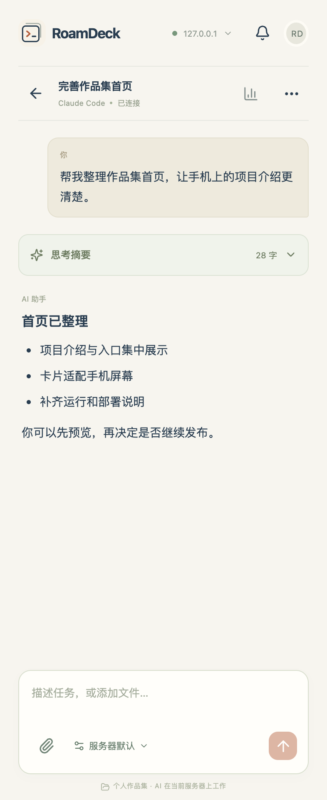
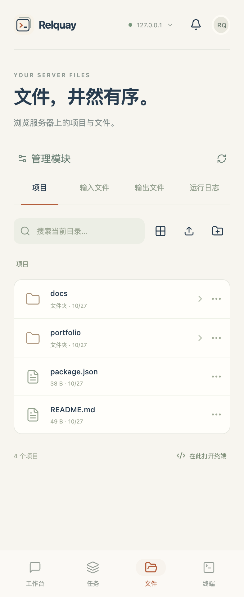
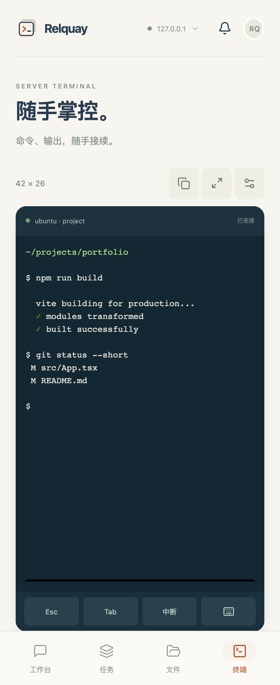

<p align="center">
  
</p>

<h1 align="center">Relquay · 云渡</h1>

<p align="center"><strong>用手机，接续服务器上的 AI 开发工作。</strong><br>Self-hosted mobile workspace for Claude Code and Codex.</p>

<p align="center">
  <a href="https://github.com/leechyi325/Relquay/actions/workflows/ci.yml"></a>
  <a href="LICENSE"></a>
  
</p>

<p align="center">
  <a href="#服务端安装与使用">快速开始</a> ·
  <a href="docs/user-guide.md">使用指南</a> ·
  <a href="#介绍视频">介绍视频</a> ·
  <a href="#界面预览">界面预览</a> ·
  <a href="https://github.com/leechyi325/Relquay/issues">反馈问题</a> ·
  <a href="#更新记录">更新记录</a>
</p>

**Relquay · 云渡**，把 Claude Code、Codex、终端、文件和后台任务放进同一个手机工作台。电脑不在身边时，也能查看进度、回答问题、批准操作、修改文件，并预览结果。

**代理和项目在你自己的服务器上运行，手机负责交互。** 支持 Android 手机、平板和浏览器，可连接多台独立部署的服务器。无需安装 Claude 手机 App，也不提供公共账号或 AI 调用额度。

## 介绍视频

工作在远端，掌握在手边。32 秒了解从手机发起任务、审阅批准，到预览结果和接收完成提醒的过程。

https://github.com/user-attachments/assets/f049a6e0-826f-4ae6-9f05-81e6abdf6efc

[播放 / 下载完整 MP4](docs/media/relquay-intro.mp4) · [演示素材说明](docs/media/README.md)

<details>
<summary>动图预览与本地播放副本</summary>

<p align="center">
  <a href="docs/media/relquay-intro.mp4"></a>
</p>

<p align="center"><a href="docs/media/relquay-intro.mp4">本地完整视频（含配乐，32 秒）</a> · <a href="docs/media/README.md">演示素材说明</a></p>

</details>

视频使用真实应用界面与虚构演示数据；通知功能需主动开启监听并授予系统权限。

## 能做什么

| 能力 | 使用场景 |
| --- | --- |
| 双代理对话 | 选择 Claude Code 或 Codex，创建/恢复/重命名会话，切换模型与思考程度 |
| 操作审阅 | 在手机上查看命令、变更和问题，明确批准、拒绝或回答 |
| 文件与附件 | 上传手机文件、引用服务器文件，自定义文件模块及多个目录 |
| 结果预览 | 查看图片、音视频、Markdown 和隔离 HTML，下载原文件 |
| 触屏终端 | 中文命令编辑、快捷命令、复制、列宽与横向查看，断线后附着原 tmux shell |
| 后台任务 | 排队执行构建、测试或批处理，查看日志、取消、编辑记录和复制重跑 |
| 用量与提醒 | 查看账号额度与按会话 Token；主动开启 Android 完成/待批准提醒 |
| 代理配置 | 引导式配置与源码编辑，管理用户级 Skills、MCP 和插件 |

## 界面预览

<p align="center">
  
  
  
</p>

<p align="center">对话与思考 · 服务器文件 · 触屏终端</p>

截图使用真实界面与虚构演示数据，不包含真实账号或项目内容。

## 服务端安装与使用

项目与 GitHub 仓库均已更名为 **Relquay · 云渡**。已有实例升级时保留原数据目录与服务名；本地仓库可运行 `git remote set-url origin https://github.com/leechyi325/Relquay.git` 更新远程地址。

当前源码版本 **0.4.6**，处于早期迭代阶段。首次使用需要部署自己的服务器，再通过浏览器或 Android App 连接。完整步骤见 [安装与首次连接](docs/getting-started.md)。

### 第一步：准备环境

- **服务器**：普通用户账号、Node.js ≥24、npm、tmux、Python 3 和构建工具。已验证 Ubuntu ARM64；依赖在目标架构安装。
- **手机公网访问**：域名、可信 HTTPS，以及云和主机防火墙放行。
- **AI 账号**：本人授权 Codex / Claude，或配置兼容的 API。工作台账号与 AI 账号分别管理。

### 第二步：安装与构建

在全新服务器的普通用户下运行：

```bash
git clone https://github.com/leechyi325/Relquay.git "$HOME/relquay/app"
cd "$HOME/relquay/app"
npm ci --include=dev
npm ci --prefix upstream
npm run build
```

这一步准备了网页、网关和锁定版本的 AI 客户端。接着按 [初始化与启动](docs/getting-started.md#3-写入运行环境) 写入环境、启动 CloudCLI、创建所有者账号，再启动网关；完成 HTTPS 与后台常驻配置后，才能通过公网使用。

已有构建环境时，可用 `npm run server:package` 生成预构建网页和服务端源码包，交给目标机器安装依赖。打包、校验与解压步骤见 [服务端包安装](docs/getting-started.md#2-获取源码或使用服务端包)。

### 第三步：连接并创建第一个项目

1. 浏览器打开你的 HTTPS 工作台，或在 Android App 中添加该服务器地址。
2. 使用初始化时保存的工作台账号登录。
3. 选择代理，新建会话，选择目录与项目名称；新项目勾选“在所选位置新建同名项目文件夹”。
4. 发送任务，在需要时审阅批准或回答问题；通过文件和预览查看结果。

只想先体验界面，可按安装指南使用 SSH 隧道在电脑浏览器访问回环服务；Android 的系统通知、输入法和后台行为需在 App 中体验。

**安装包获取**：目前提供源码构建与本地打包流程，首页不预置实例地址或共享账号。若 [Releases](https://github.com/leechyi325/Relquay/releases) 尚无对应版本附件，请自行构建服务端包和 [Android APK](docs/deployment.md#android-构建)。修改网页后，已安装 App 仍需新 APK 才能更新内置界面。

<details>
<summary>展开完整服务端安装步骤（环境、账号、启动与手机连接）</summary>


以下步骤面向全新服务器。已有实例请先看[升级流程](docs/deployment.md#升级既有实例)，不要直接覆盖生产目录。手机 App 是操作入口，服务器上的 Relquay、CloudCLI 和 AI 客户端才负责实际运行；无须安装 Claude 手机 App。

#### 1. 准备一台服务器

当前实际验证环境是 Ubuntu ARM64；源码和轻量服务端包都不捆绑机器架构相关的 node_modules，目标机按锁文件安装。准备：

- 普通用户账号、**Node.js ≥24 和 npm**，用 `node -v` / `npm -v` 检查；系统包仓库的旧 Node 可能不满足要求。
- `git`（从源码安装时）、`tmux`、`python3`、`make`、`g++`、CA 证书。Ubuntu 可运行 `sudo apt-get update`，再 `sudo apt-get install -y git tmux python3 make g++ ca-certificates`；Node.js 另外安装到满足版本。
- 公网使用的域名、可信 HTTPS 和云/主机防火墙规则；先在回环验证，再开放反代入口。

不要以 root 身份运行代理；项目、账号和配置归运行工作台的普通用户所有。

#### 2. 获取源码，或使用服务端包

源码安装：

```bash
git clone https://github.com/leechyi325/Relquay.git "$HOME/relquay/app"
cd "$HOME/relquay/app"
npm ci --include=dev
npm ci --prefix upstream
npm run build
```

`upstream` 安装锁定的 CloudCLI、Codex 和 Claude Code，不要求全局 npm 安装。网关通过 tsx 启动，所以应用依赖目前需要包含 devDependencies。

也可以在已有完整 Git 源码和依赖的电脑上运行：

```bash
npm run server:package
```

生成 `artifacts/relquay-server-0.4.6.tar.gz` 及同名 `.sha256`，上传到服务器的私有目录。包内有预构建网页、服务端及相关源码、锁文件和文档，**不含依赖、AI 账号、工作台账号、AGENTS.md、项目文件或 APK**。它是联网安装包，不是离线单文件程序；当前不自动发布到 GitHub Releases。

收到包与校验文件后，在两者所在目录执行：

```bash
sha256sum -c relquay-server-0.4.6.tar.gz.sha256
mkdir -p "$HOME/relquay/app"
tar -xzf relquay-server-0.4.6.tar.gz --strip-components=1 -C "$HOME/relquay/app"
cd "$HOME/relquay/app"
npm ci --include=dev
npm ci --prefix upstream
```

已有预构建网页，不再需要 `npm run build`。这两条路线后续步骤相同；安装目录应为空，新服务器不要套用到已有生产目录。

#### 3. 写入运行环境

下面将程序、数据和账号分开，路径不依赖旧实例的 `/home/ubuntu/compileverse`。先把示例 `STUDIO_ORIGIN` 改成你将使用的 HTTPS 域名与端口：

```bash
mkdir -p "$HOME/relquay"
cat > "$HOME/relquay/env.sh" <<'SH'
export RELQUAY_APP="$HOME/relquay/app"
export PATH="$RELQUAY_APP/upstream/node_modules/.bin:$PATH"
export STUDIO_BASE="$HOME/relquay/workspace"
export STUDIO_STATE="$HOME/relquay/state"
export STUDIO_ACCESS_FILE="$HOME/relquay/access.json"
export STUDIO_OWNER_USERNAME=owner
export STUDIO_HOST=127.0.0.1
export STUDIO_PORT=3080
export CLOUDCLI_URL=http://127.0.0.1:3001
export STUDIO_ORIGIN=https://workspace.example.com:28443
export STUDIO_ENV_FILE="$HOME/relquay/env.sh"
SH
chmod 600 "$HOME/relquay/env.sh"
source "$HOME/relquay/env.sh"
mkdir -p "$STUDIO_BASE"/{project,inputs,outputs,logs,studio} "$STUDIO_STATE"
chmod 700 "$STUDIO_STATE"
cat > "$STUDIO_BASE/studio/terminal.rc" <<'SH'
if [ -f "$HOME/.bashrc" ]; then source "$HOME/.bashrc"; fi
source "$HOME/relquay/env.sh"
SH
```

网关不会自动读取 `.env`，每次启动都要加载此环境。修改 `RELQUAY_APP` 路径时，同步后续命令和服务配置。

#### 4. 启动 CloudCLI，建立工作台账号，再启动网关

在第一个 SSH 终端启动 CloudCLI，保持它运行：

```bash
source "$HOME/relquay/env.sh"
cd "$RELQUAY_APP"
HOST=127.0.0.1 SERVER_PORT=3001 NODE_ENV=production cloudcli
```

在第二个 SSH 终端执行：

```bash
source "$HOME/relquay/env.sh"
cd "$RELQUAY_APP"
node scripts/bootstrap-owner.mjs
npm run server
```

初始化脚本仅访问回环 CloudCLI，首次创建 `owner` 和随机密码，保存在权限 600 的 `$HOME/relquay/access.json`，不打印密码。由你在服务器私下查看该文件并用于登录；不要上传或分享。重复初始化会保留既有凭据。若注册时网络失败，文件也保留；先检查 CloudCLI 状态，确认账号是否已经建立，不要直接删掉凭据文件重来。已有 CloudCLI 账号但缺失凭据文件时不会自动重置账号。

第三个终端检查：

```bash
curl -f http://127.0.0.1:3080/api/health
curl -s -o /dev/null -w '%{http_code}\n' http://127.0.0.1:3080/api/files
```

应分别得到健康 JSON（0.4.6）和 **401**。初次试用可从电脑建立 `ssh -L 3080:127.0.0.1:3080 用户@服务器`，在浏览器访问 `http://127.0.0.1:3080`。公网手机使用下一步的 HTTPS。

#### 5. 配置 HTTPS 与后台常驻

将可信 HTTPS 反向代理指向 `127.0.0.1:3080`，支持 WebSocket 和文件上传；只对公网开放反代端口，CloudCLI 3001 和网关 3080 保持回环。非标准端口证书可使用 DNS-01，证书不会因为端口放行而自动签发。

前面的两个前台进程用于首次验证，SSH 关闭会停止它们。验证后按 [通用 systemd 用户服务](docs/deployment.md#通用-systemd-用户服务) 配置常驻与开机启动，再关闭前台进程，避免端口冲突。HTTPS 示例与证书维护见 [部署文档](docs/deployment.md#新服务器的-https-反向代理)。旧 `install-server.sh` / `publish-https.sh` 仍服务于旧实例，**不用于这条通用安装路线**。

#### 6. 授权 AI 并从手机连接

以同一服务器用户加载环境后，运行 `codex login`，以及 `claude auth login`，由账号本人按 CLI 指引授权；第三方接口也可在代理设置里按 [配置指南](docs/configuration.md) 填写。工作台登录和 AI 授权是两套账号，安装客户端不代表已登录。长期服务也必须使用同一用户、home 和环境。

安装 Android APK，在服务器列表添加实际 HTTPS 地址，用工作台账号登录。使用其他人的预构建 APK 也可添加自己的服务器，无须为每个域名重新构建 App。Android 打包仅在修改客户端或首次分发 APK 时需要；见 [Android 构建](docs/deployment.md#android-构建)。

服务端包和首次安装步骤不会自动配置 DNS、防火墙、TLS、systemd 或 AI 授权，这些需要服务器所有者完成。既有生产实例升级请走 [维护流程](docs/deployment.md#升级既有实例)，先备份并确认没有运行任务，不要直接重新安装。


</details>

## 常见问题

<details>
<summary>服务端必须安装 Android Studio 或模拟器吗？</summary>

不需要。服务器运行网关、代理和任务；Android 工具用于编译与测试 App。APK 可以在另一台适合 Android 工具链的机器上构建，安装到真机测试。Oracle ARM 可承担服务端与网页开发，不应把完整 Android 开发工具链当成运行前提。

</details>

<details>
<summary>我已经有 Claude / Codex 账号，还要再建什么账号？</summary>

工作台登录保护你的服务器、文件和终端，由部署者初始化；AI 账号授权决定代理能否调用模型。两者不同。模型目录可见也不代表账号拥有调用权限。

</details>

<details>
<summary>为什么有常驻通知，却没有任务完成提醒？</summary>

监听服务与任务提醒使用不同的 Android 通知频道。到“提醒中心 → 后台提醒设置”发送测试提醒，检查任务频道、最近同步和登录状态。后台通知需要主动开启；省电限制、强停和断网可能延迟提醒。详细排查见 [使用指南](docs/user-guide.md#android-系统通知)。

</details>

<details>
<summary>能直接提供公共服务或多人共用吗？</summary>

当前按单一所有者设计，登录者可以执行服务器命令和管理文件。它不是多租户平台。多服务器指手机保存多台独立服务器的入口与登录状态。

</details>

<details>
<summary>目前有哪些使用边界？</summary>

支持 Android 与浏览器，暂无 iOS 安装包；没有独立 Git 图形界面、项目级扩展覆盖管理、FCM/Telegram 或浏览器后台推送。Token 数据来自代理实际报告，Codex 线程累计与 Claude 上下文快照不可混作账单。媒体能力取决于浏览器/WebView。测试范围见 [验证记录](docs/validation.md)。

</details>

## 文档导航

| 文档 | 内容 |
| --- | --- |
| [安装与首次连接](docs/getting-started.md) | 从源码或服务端包安装，环境、账号、启动与手机连接 |
| [使用指南](docs/user-guide.md) | 会话、附件、文件、终端、任务、通知和故障排查 |
| [代理配置与扩展](docs/configuration.md) | 连接、密钥、模型、Skills、MCP 和插件 |
| [部署与维护](docs/deployment.md) | systemd、HTTPS、备份、升级、回滚与 Android 打包 |
| [架构与合同](docs/architecture.md) | 数据流、接口、鉴权和实现约束 |
| [验证记录](docs/validation.md) | 已验证范围、脚本及实际设备/模型验收边界 |
| [贡献指南](CONTRIBUTING.md) | 开发环境、验证要求和提交 PR |
| [安全反馈](SECURITY.md) | 如何报告敏感问题 |

## 参与开发

欢迎提交可复现的问题、具体的功能建议和 Pull Request。开始前请阅读 [贡献指南](CONTRIBUTING.md)；文档、手机交互和不同环境的兼容性反馈都很有帮助。

```bash
npm ci
npm run typecheck
npm test
npm run build
```

网页开发使用 `npm run dev`，网关使用 `npm run server`，代理需要独立运行。首次开发配置见 [贡献指南](CONTRIBUTING.md#本地开发)。界面变化另做浏览器截图检查，原生变化再构建 APK 和验收；仅文档改动无需模拟器。

```text
src/       React 手机/平板界面
server/    Express 网关与代理桥、文件和任务
shared/    协议、配置与显示逻辑
android/   Capacitor Android 工程
scripts/   构建、打包与验收
upstream/  服务器客户端依赖锁文件
docs/      安装、使用、配置和维护说明（media/ 为首页演示成片）
```

## 致谢

界面使用 React、Capacitor、xterm.js 和 Lucide；代理接入依托 CloudCLI 与原生 Codex App Server。手机交互设计参考 [HAPI](https://github.com/tiann/hapi) 和 [Paseo](https://github.com/getpaseo/paseo)。Relquay 的产品界面和适配层独立实现；依赖及上游工具保留各自的许可证与使用条款。

## 许可证

本项目采用 [MIT License](LICENSE)。第三方依赖、上游工具与服务账号授权分别遵循其自身条款。

## 更新记录

<details>
<summary>展开版本历史（当前 0.4.6）</summary>


按版本倒序记录源码变化；部署状态见验证文档。历史条目描述当时行为，当前操作入口以使用指南为准；当前版本 0.4.6。

### 未发布

- 设置新增「外观」：跟随系统 / 浅色 / 深色；深色样式由 `scripts/make-dark.mjs` 从浅色样式生成，Android 状态栏与导航栏图标随主题切换。
- 文件列表、预览页与会话列表显示修改时分（跨年显示完整日期）。
- Claude 会话 Token 新增从会话记录统计的累计值（新输入/输出/缓存读写/调用次数）与上下文占用百分比；新一轮的全 0 上报不再覆盖已有快照。
- 对话内「额度与 Token」只显示当前代理的账号额度和本会话统计，其他会话折叠在「查看其他会话」。
- 发送被拒绝时，文字与附件自动回填输入框。
- 后台任务列表支持查看与停止；发送被拒绝时保留停止按钮。

### 0.4.6 · 2026-10-28

- 产品更名为 **Relquay · 云渡**，更新应用、网页与通知显示名称。
- 新安装包使用 `relquay` 前缀；保留 Android 包名、签名和已有凭据、服务器配置与提醒设置。
- Android versionCode 13；GitHub 仓库更名为 `leechyi325/Relquay`，安装、贡献与反馈入口同步更新。
- README 增加无署名介绍视频与紧凑预览；演示成片集中在 `docs/media/`，动画源码、原始素材及历史渲染保留在独立制作目录。

### 0.4.5 · 2026-10-27

- 配套交付新增可构建的轻量服务端包与通用手动安装步骤；更新记录合并到本页，本地 AGENTS 不随仓库分发。
- 文档补充界面预览、首次使用和贡献入口，采用 MIT 许可证。
- Token 总计/日行及按会话统计默认折叠，支持代理筛选、搜索和别名会话的最新快照。
- 代理配置新增保留当前/官方/自定义连接、地址、认证、模型与思考程度的引导字段及源码切换。
- Codex 服务器默认选项遵循原生模型/effort；显式会话选择仍可覆盖。
- 配置保存栏随页面滚动，修复实际 Android 输入法下遮挡编辑框的问题。
- Android versionCode 12，保留包名与签名兼容。

### 0.4.4

- 修复 Codex 原生线程别名造成的重复会话，保留同名独立对话。
- 完善 GFM Markdown、代码复制、可折叠思考和更早历史读取。
- Android 增加独立任务提醒频道诊断、同频道测试、重开监听恢复，修复首次同步窗口内完成提醒。
- Android versionCode 11。

### 0.4.3

- 对话隐藏底部主导航，用量收至标题栏图标；支持会话重命名，设置按钮居中。
- 提醒导航解析真实会话，已删除/归档目标给出明确提示；自有 Codex 元数据可恢复缺失目录记录的会话。
- Android versionCode 10。

### 0.4.2

- 网关本机处理 secondary DA 协商，拦截重复终端设备响应，修复慢网下 `0;276;0c` 进入输入；兼容旧 0.4.1 客户端。
- 保留原 shell、用户输入和历史。Android versionCode 9。

### 0.4.1

- 终端自定义快捷命令；菜单切换保留连接、缓冲区和草稿。
- 实际重连重新附着既有 tmux shell，复制合并软折行、保留真实换行。
- Android versionCode 8。

### 0.4.0

- 代理卡片旁统一配置 / Skills / MCP / 插件入口，管理用户级扩展。
- 文件改紧凑图标工具栏，终端次要按钮收进工具面板。
- 额度重置标明设备时区、GMT 偏移和剩余时间。

### 0.3.1

- 统一模型选择视觉、新建文件夹位置；终端增加留白、复制与手动选择。
- 任务支持编辑、删除和复制重跑；新增固定用户配置文件编辑与冲突检测。

### 0.3.0

- 账号额度与已报告 Token、用量来源和缺失状态。
- 持久提醒收件箱、多服务器 Android 前台监听与系统通知。

### 0.2.0

- 本机保存多服务器、分别登录与切换，迁移旧凭据。
- 自定义文件模块与多文件夹、手机/服务器附件、模型与思考选项、交互批准和问答。

### 0.1.2

- Android 仅信任系统 CA，不随 APK 分发实例专用 CA；公开 HTTPS 使用可信证书。

### 0.1.1

- 新建会话选择目录、项目名，支持会话删除且保留文件。
- 终端适应屏宽、固定列宽、横向查看、字号和全屏。

### 0.1.0

- 首版 Android / 网页工作台、双代理桥、文件预览、PTY 与后台任务。
- 独立所有者登录、HTTPS、Keystore 与真实 ARM 部署。

</details>
